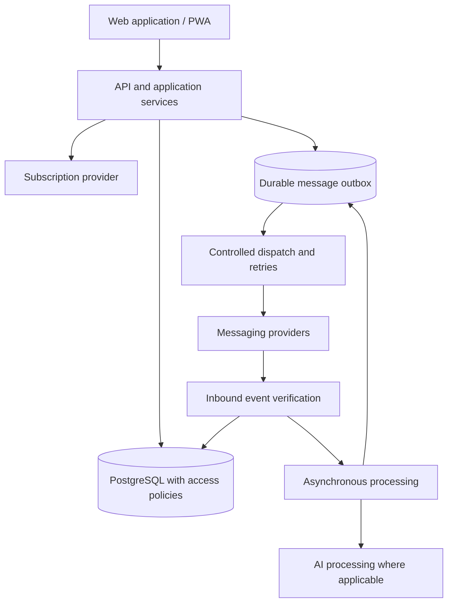

# NexoLumi CRM — Software Engineering Case Study

**SaaS Architecture · Multi-tenancy · Messaging Systems · Reliability · Application Security**

[Versão em português](README.md) · [Product](https://nexolumicrm.app.br) · [Portfolio](https://07devpagerp.com.br) · [GitHub profile](https://github.com/luisfecarneiro-dev)

> **This is an engineering case study, not the product's source repository.** It describes design choices, real engineering challenges and reported validation evidence without disclosing proprietary source code, internal configuration or customer data.

## Overview

**NexoLumi CRM** is an independently developed SaaS product for commercial operations and customer relationship management. Its engineering scope includes workspaces, contacts, deal pipelines, messaging inboxes, WhatsApp integrations, automation workflows, AI capabilities, subscription billing and a progressive web app.

**My role:** product creator and primary full-stack developer, working on software architecture, implementation, integrations, troubleshooting, documentation and product evolution through 07Dev.

**Status as of October 11, 2026:** the product has a deployed web application and is undergoing stable-release validation. A private release report records successful local quality checks and several production observations, but the **Stable release remains NO-GO** until outstanding CI, extended monitoring, and final real-world pilot criteria are met. This case study does not claim the product is defect-free.

## Engineering challenge

A business messaging product cannot assume that every external HTTP request succeeds exactly once. It must handle provider outages, duplicate deliveries, message synchronization, media processing, access control, recurring subscriptions, and strict boundaries between organizations. Reliability and traceability matter as much as the user interface.

## Technology overview

| Area | Technologies used |
| --- | --- |
| Web application | Next.js (App Router), React, TypeScript, Tailwind CSS |
| State and UI | Zustand, TanStack Query, Radix-based components, React Flow |
| Data and identity | PostgreSQL, Supabase, authentication, Row Level Security (RLS) |
| Services | Node.js, Fastify, Python/FastAPI |
| Messaging | WhatsApp Cloud API, Baileys integration, webhooks, asynchronous processing |
| Integrations | Stripe Billing and LLM APIs |
| Engineering quality | Vitest, pytest, static analysis, type checking, builds, contract tests |

This summarizes the documented architecture, rather than guaranteeing the exact runtime inventory at every point in time.

## High-level architecture

*Conceptual diagram: intentionally excludes sensitive infrastructure specifics.*

## What I designed and investigated

- **Tenant isolation:** permission boundaries at application and database levels, with RLS and isolation-oriented checks.
- **Durable messaging:** asynchronous processing, outbox, retries and idempotency to avoid silent message loss during external provider failures.
- **Media semantics:** corrected a real issue where message/media type was not consistently persisted. Source-provided media classification was preserved rather than guessed from MIME alone.
- **Integration boundaries:** provider-specific contracts, webhook verification, authorization and error states.
- **Evidence-based delivery:** separate local test success from CI success, real-world verification, soak monitoring and a stable-release decision.

The [architecture decisions](docs/03-decisions.md) and [messaging reliability analysis](docs/04-messaging-reliability.md) explain the reasoning and trade-offs.

## Engineering evidence — with qualifications

The private quality report for the candidate assessed on **October 11, 2026** recorded:

- **6,324 passing tests** across frontend, messaging, gateway, contracts, observability and AI tests. One additional frontend test was skipped and one was marked todo.
- A composite local quality command completing with **exit code 0**, including static checks and a production frontend build.
- Selected provider and runtime observations, alongside explicit outstanding pilot and extended-monitoring requirements.
- **This is not a verified public CI green state or a Stable release approval.** The underlying logs and detailed evidence are private; numbers are reported from private release documentation and were not rerun in this public case-study repository.

Read [quality and release](docs/06-quality-and-release.md) for a careful distinction between implemented, tested, observed, and pending.

## Technical documentation

| Document | Focus |
| --- | --- |
| [Context and scope](docs/01-context.md) | Requirements and responsibility boundaries |
| [Architecture](docs/02-architecture.md) | Components, data flow and service boundaries |
| [Architecture decisions](docs/03-decisions.md) | Trade-offs and decision records |
| [Messaging reliability](docs/04-messaging-reliability.md) | Events, media, retries, idempotency |
| [Security and privacy](docs/05-security.md) | RLS, authentication, webhooks and data protection |
| [Quality and release](docs/06-quality-and-release.md) | Test evidence, qualifications and release gates |
| [Lessons learned](docs/07-lessons-learned.md) | Root causes, iteration and next steps |
| [Interview walkthrough](docs/08-recruiter-walkthrough.md) | Questions to discuss with a technical interviewer |

## Confidentiality boundary

No original product code, keys, tokens, user logs, customer records, database dumps, private service URLs or internal network topology are included. Any examples are **illustrative explanations**, not production implementation excerpts.

## Author

**Luís Felipe Guimarães Isaías Carneiro** — Full Stack Developer · 07Dev  
[GitHub](https://github.com/luisfecarneiro-dev) · [Portfolio](https://07devpagerp.com.br)

Case-study snapshot: **October 11, 2026**. See [NOTICE.md](NOTICE.md) for rights and disclosure limits.

**Publishing instructions:** [PUBLISHING.md](PUBLISHING.md).
