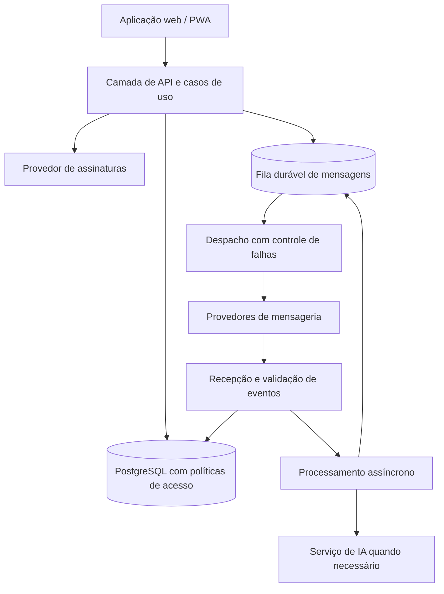

# NexoLumi CRM — Estudo de caso de engenharia

**Arquitetura SaaS · Sistemas multi-tenant · Mensageria · Confiabilidade · Segurança de aplicações**

[English version](README.en.md) · [Produto](https://nexolumicrm.app.br) · [Portfólio](https://07devpagerp.com.br) · [Perfil no GitHub](https://github.com/luisfecarneiro-dev)

> **Repositório de estudo de caso, não código-fonte do produto.** Este material foi escrito para explicar escolhas de engenharia, problemas reais e evidências de validação sem expor código proprietário, configurações internas ou dados de clientes.

## Visão geral

O **NexoLumi CRM** é um produto SaaS próprio voltado à gestão comercial e ao relacionamento com clientes. O escopo de desenvolvimento abrange workspaces, contatos, oportunidades, inbox de mensagens, integrações com WhatsApp, automações, recursos de IA, assinaturas e PWA.

**Meu papel:** criador e desenvolvedor principal, responsável por desenho técnico, implementação full stack, integrações, evolução do produto, diagnósticos e documentação. O projeto é desenvolvido na 07Dev.

**Status em 11/10/2026:** produto publicado e em preparação para a versão estável. O relatório interno de release registra testes locais e verificações importantes aprovados, mas **a decisão final para Stable é NO-GO** enquanto CI, monitoramento prolongado e validação final com usuários/provedores não estiverem concluídos. Este estudo de caso não afirma que o software está livre de falhas.

## O problema de engenharia

Uma ferramenta comercial com comunicação por mensagens não pode depender de uma única requisição HTTP bem-sucedida. É preciso lidar com indisponibilidade de provedores, mensagens repetidas, sincronização entre canais, arquivos de mídia, permissões de equipes, cobrança recorrente e dados de organizações diferentes — tudo sem perder a rastreabilidade operacional.

O desafio foi estruturar um produto com interface responsiva e serviços especializados, sem transformar integração externa em ponto único de falha silenciosa.

## Stack utilizada no projeto

| Área | Tecnologias utilizadas |
| --- | --- |
| Aplicação web | Next.js (App Router), React, TypeScript, Tailwind CSS |
| Estado e interface | Zustand, TanStack Query, componentes baseados em Radix, React Flow |
| Dados e identidade | PostgreSQL, Supabase, autenticação e Row Level Security (RLS) |
| Serviços | Node.js, Fastify, Python/FastAPI |
| Mensageria | WhatsApp Cloud API, integração Baileys, webhooks, processamento assíncrono |
| Integrações | Stripe Billing, APIs de modelos de IA |
| Qualidade | Vitest, pytest, checagem de tipos, lint, build e testes de contratos |

As bibliotecas e a topologia evoluem ao longo do projeto; esta tabela é uma síntese arquitetural, não um inventário de produção em tempo real.

## Arquitetura em alto nível

*Diagrama conceitual resumido; não representa endpoints, redes, segredos ou topologia operacional completa.*

## Decisões técnicas com maior valor

1. **Isolamento por organização.** Identidade, permissões e fronteiras de dados foram tratadas como requisitos de arquitetura, incluindo políticas RLS e testes de isolamento.
2. **Mensageria durável.** O processamento assíncrono usa conceitos de outbox, retry e idempotência para que uma falha de provedor não signifique, por definição, perda silenciosa da intenção de envio.
3. **Classificação canônica de mídia.** Um defeito real mostrou que deduzir o tipo de mensagem apenas pelo MIME pode confundir áudio e mensagem de voz. O fluxo foi ajustado para preservar a classificação explícita de origem.
4. **Integrações por contratos.** Provedores de mensagens, pagamentos e IA precisam de limites claros, validação de eventos, estados de erro e rastreabilidade.
5. **Release com evidência.** Testes locais aprovados não bastam, isoladamente, para declarar uma versão estável. O processo diferencia validação local, CI, ambiente real, soak e pilot.

Veja [decisões arquiteturais](docs/03-decisions.md) e [confiabilidade da mensageria](docs/04-messaging-reliability.md).

## Evidências e limitações

O registro interno de qualidade associado ao candidato de release analisado em **11/10/2026** informa:

- **6.324 testes aprovados** somando suítes de frontend, mensageria, gateway, contratos, observabilidade e serviço de IA, com 1 teste marcado como `skipped` e 1 como `todo` no frontend.
- Execução local composta de qualidade com resultado **exit code 0**, incluindo build e checagens estáticas.
- Registros de validação de fluxos com provedores externos, além de pendências documentadas de aceitação e monitoramento.
- **Ainda não é uma certificação pública nem um lançamento Stable aprovado.** As evidências completas estão em repositório privado; os números são transcritos de relatórios internos, não reexecutados neste repositório.

Leia [qualidade e política de evidências](docs/06-quality-and-release.md) para a separação entre *implementado*, *testado*, *observado* e *pendente*.

## Documentação do estudo de caso

| Documento | O que demonstra |
| --- | --- |
| [Contexto e escopo](docs/01-context.md) | Análise de requisitos e delimitação de responsabilidades |
| [Arquitetura](docs/02-architecture.md) | Decomposição, fluxos e limites de serviços |
| [Decisões / ADRs](docs/03-decisions.md) | Trade-offs e razões por trás das escolhas |
| [Confiabilidade de mensagens](docs/04-messaging-reliability.md) | Tratamento de eventos, mídia, retries e idempotência |
| [Segurança e privacidade](docs/05-security.md) | RLS, autenticação, verificação de webhooks e cuidados com dados |
| [Qualidade e release](docs/06-quality-and-release.md) | Evidências, ressalvas e critérios de go/no-go |
| [Aprendizados](docs/07-lessons-learned.md) | Problemas encontrados, correções e próximos passos |
| [Guia para entrevista](docs/08-recruiter-walkthrough.md) | Perguntas técnicas e caminhos para avaliar o trabalho |

## O que este repositório **não** contém

Não há código-fonte original do NexoLumi, credenciais, segredos, logs de usuários, dumps de bancos, diagramas de rede internos, identificadores de contas, tokens ou configurações de produção. Os exemplos são explicativos e **não podem ser interpretados como código executado em produção**.

## Autor

**Luís Felipe Guimarães Isaías Carneiro** — Desenvolvedor Full Stack · 07Dev  
[GitHub](https://github.com/luisfecarneiro-dev) · [Portfólio](https://07devpagerp.com.br)

Última consolidação do estudo: **11 de outubro de 2026**. Consulte [NOTICE.md](NOTICE.md) para escopo de uso e propriedade intelectual.

**Publishing instructions:** [PUBLISHING.md](PUBLISHING.md).
