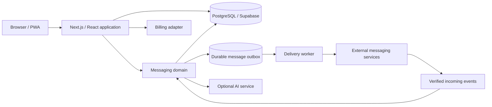
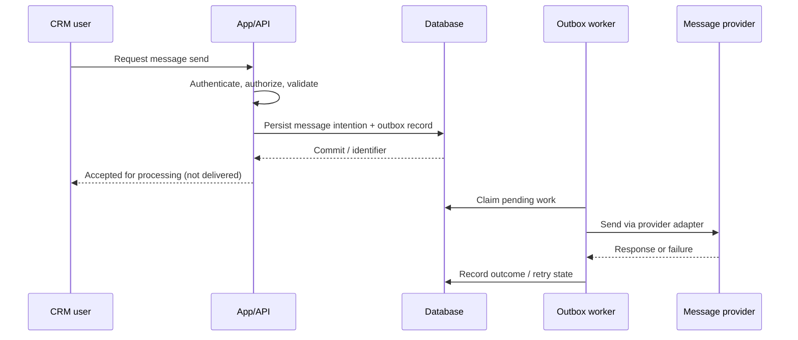

# 02 — High-level architecture

## System overview

The diagram is intentionally schematic and omits infrastructure-level details.

## Separation of concerns

**Web application:** rendering, navigation, authenticated workflows, workspace context, user-initiated commands, human-readable error states.

**Domain/application services:** operations such as adding a contact, changing a deal, initiating an outbound message or interpreting an incoming event; responsible for validation, authorization and transaction boundaries.

**Data layer:** relational persistence; explicit workspace ownership; policies that constrain access according to user identity and permitted memberships. RLS supplements server-side authorization rather than replacing it.

**Messaging adapters:** normalize provider-specific inbound/outbound contracts while retaining necessary provider context. Protect internal workflows from schema differences.

**Asynchronous workers:** execute work that should survive a web request lifecycle; preserve retry and diagnostic state.

**Integration adapters:** billing and AI dependencies are treated as external systems whose responses must be validated and whose failures must be visible.

## Example: outbound message lifecycle

*Illustrative flow based on system design. Actual delivered status requires provider evidence; queuing is not equivalent to delivery.*

## Architectural trade-offs

- **Asynchronous processing** improves recoverability but adds coordination, observability and duplicate-handling requirements.
- **Multiple providers** increase interoperability and operational complexity.
- **RLS** can add defense in depth, but policy correctness and service-role boundaries must be continuously audited.
- **PWA/mobile** improves accessibility of the product but requires explicit handling for cached state and offline limitations.

## Scope boundaries

No private paths, specific production service hosts, production identifiers, exact permission predicates, network configurations or service credentials are included.

